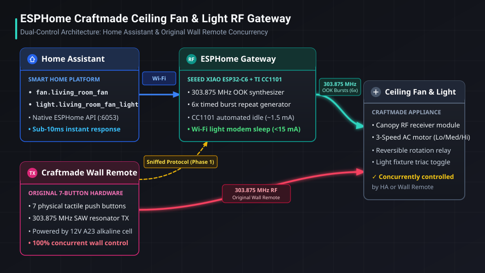
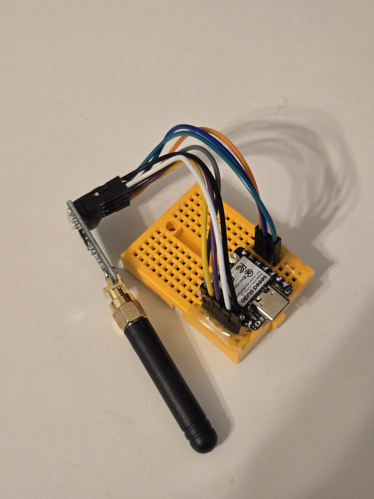
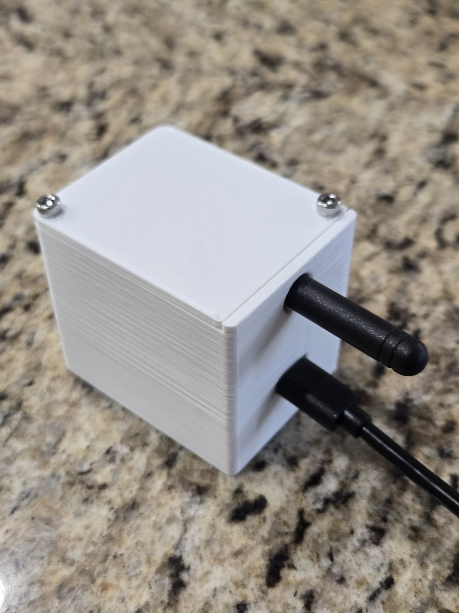
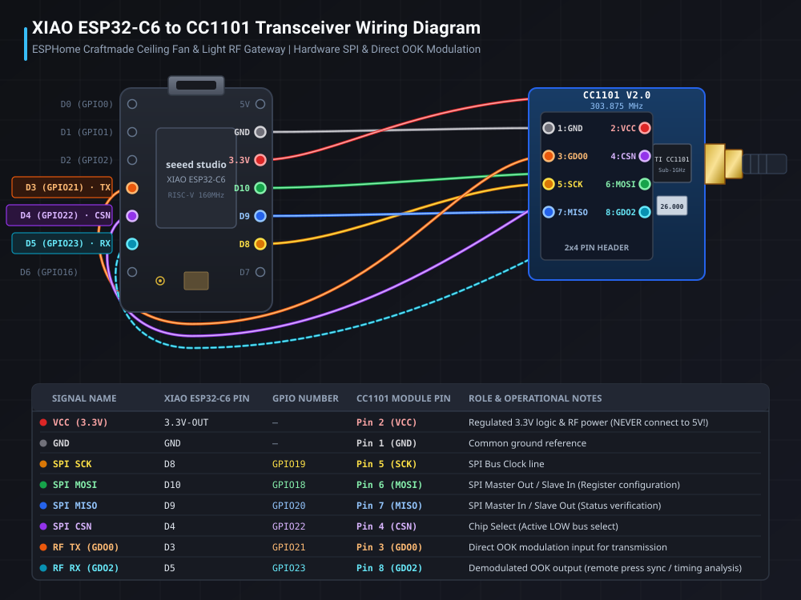
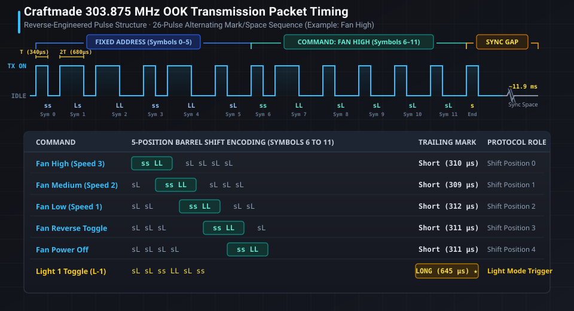
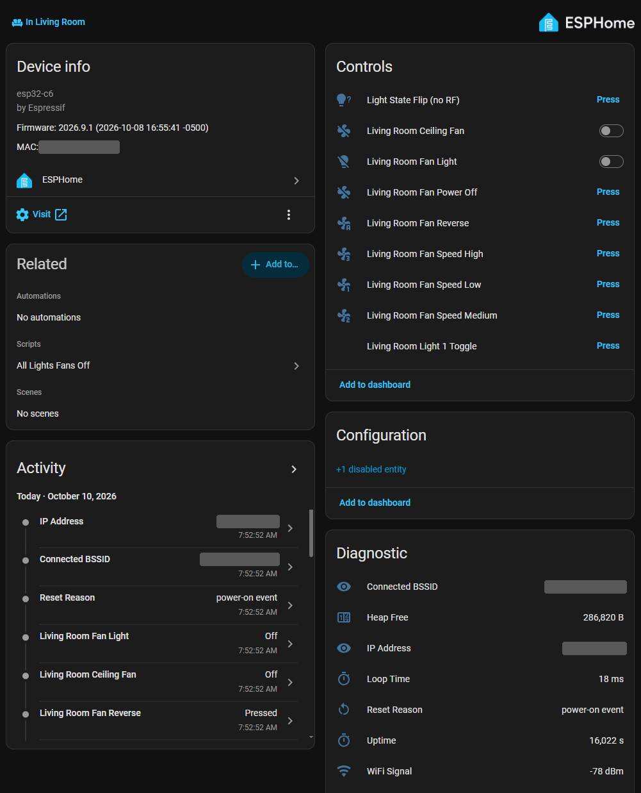

# ESPHome Craftmade Ceiling Fan & Light RF Gateway

[](https://esphome.io/)
[](https://www.seeedstudio.com/Seeed-Studio-XIAO-ESP32C6-p-5884.html)
[](https://www.amazon.com/dp/B0D2TMTV5Z)
[]()
[](LICENSE)

A non-invasive, low-power smart gateway bridging a **303.875 MHz Craftmade ceiling fan and light** into **Home Assistant** using **ESPHome**, a **Seeed Studio XIAO ESP32-C6**, and a **Texas Instruments CC1101** Sub-1 GHz transceiver.

The original physical wall remote continues to operate normally with zero modifications or rewiring, while Home Assistant gains full, native wireless control over fan speeds, direction, and lighting. The gateway also **listens** for the original remote, so presses on it show up in Home Assistant and the displayed fan and light state stays in sync.

---

## Architecture Overview



---

## Photos & Prototypes

| Original Wall Remote | CC1101 Transceiver Module |
| :---: | :---: |
|  |  |
| *Craftmade 7-button wall controller (Model 12V)* | *TI CC1101 with SMA Antenna port* |

| Prototype Wiring Setup | 3D Printed Enclosure |
| :---: | :---: |
|  |  |
| *Working prototype: XIAO ESP32-C6 and CC1101 on a mini breadboard with jumper wires* | *Final build in its 3D-printed case, SMA antenna and USB-C power out the side* |

---

## Key Highlights

* **Concurrent Dual Control:** The original Craftmade wall remote and Home Assistant control the fan simultaneously without interference or desynchronization.
* **Non-Invasive Installation:** No line voltage rewiring or ladder climbing required. The gateway transmits RF commands directly to the existing receiver in the fan canopy.
* **Remote Press Sync:** The CC1101 stays in receive mode between transmissions and decodes presses on the original remote (fan Low / Medium / High / Off and the light toggle). Each press updates the Home Assistant `fan` and `light` entities **without transmitting anything back**, so the two never fight. See [RF Press Sync](#rf-press-sync).
* **Safe Light Handling:** The light's RF code is a *toggle*, so the firmware tracks the believed bulb state and only transmits when a command actually changes it. A redundant "off" (for example from an all-lights-off script) does nothing instead of turning the light on.
* **Silent Boot:** Nothing is transmitted while the device boots and restores state, so a power cycle never flips the fan or light.
* **Always-Transmit Buttons:** The `button` entities send their RF code regardless of what Home Assistant thinks the state is, then update the displayed state to match. A **Light State Flip (no RF)** button corrects Home Assistant's view of the light without sending anything.
* **Diagnostics Included:** Uptime, Wi-Fi signal, BSSID, free heap, loop time and reset reason are exposed as diagnostic entities so dropouts and reboots are easy to explain.
* **Reverse-Engineered Timings:** Mean pulse intervals computed over high-sample-rate continuous sniffer captures, achieving 100% transmission reliability with 6x repeat bursts.
* **Native Home Assistant Entities:** Exposes standard `fan` (with 3-speed step mapping), binary `light`, and discrete action `button` entities.

> [!NOTE]
> Wi-Fi power save is set to `NONE`. Modem sleep (`LIGHT`) saved power but the device repeatedly dropped off Wi-Fi for hours at a time at about -83 dBm. The unit is wall-powered, so reliability wins. If your signal is weak, antenna or access point placement matters more than any firmware setting.

---

## Hardware Bill of Materials

| Component | Description | Reference Link |
| :--- | :--- | :--- |
| **Microcontroller** | Seeed Studio XIAO ESP32-C6 (RISC-V 160MHz, Wi-Fi 6, BLE 5, USB-C) | [Seeed Studio](https://www.seeedstudio.com/Seeed-Studio-XIAO-ESP32C6-p-5884.html) |
| **RF Transceiver** | TI CC1101 Sub-1 GHz Wireless Transceiver Module with SMA Antenna | [Amazon](https://www.amazon.com/dp/B0D2TMTV5Z) |
| **Antenna** | 315/433 MHz SMA rubber ducky antenna (included with module) | Included |
| **Power Supply** | Standard 5V USB-C power adapter | Standard |
| **Enclosure** | Custom 3D-printed compact housing (screw-down lid, SMA antenna and USB-C cutouts) | Printed in-house |

---

## Hardware & Wiring

The Texas Instruments CC1101 communicates with the ESP32-C6 via hardware SPI. In addition, **GDO0** is connected to a dedicated output pin for direct 100% duty-cycle OOK modulation, and **GDO2** is wired as the receive input, used for timing analysis during development and for decoding the original remote in production.



### Pinout Mapping Table

> [!CAUTION]
> The CC1101 operates strictly on **3.3V logic and power**. Connect VCC to the **3.3V-OUT** pin of the XIAO ESP32-C6, **NEVER** to 5V / VBUS.

| Signal | XIAO Silk Pin | ESP32-C6 GPIO | CC1101 Pin | Wire Color (Diagram) | Description |
| :--- | :--- | :--- | :--- | :--- | :--- |
| **VCC** | `3.3V-OUT` | — | **Pin 2** (`VCC`) | 🔴 Red | 3.3V Regulated Power |
| **GND** | `GND` | — | **Pin 1** (`GND`) | ⚫ Gray/Black | Common Ground |
| **SPI SCK** | `D8` | `GPIO19` | **Pin 5** (`SCK`) | 🟡 Amber | SPI Bus Clock |
| **SPI MOSI** | `D10` | `GPIO18` | **Pin 6** (`MOSI`) | 🟢 Green | SPI Master Out |
| **SPI MISO** | `D9` | `GPIO20` | **Pin 7** (`MISO`) | 🔵 Blue | SPI Master In |
| **SPI CSN** | `D4` | `GPIO22` | **Pin 4** (`CSN`) | 🟣 Purple | SPI Chip Select (Active LOW) |
| **RF TX (GDO0)** | `D3` | `GPIO21` | **Pin 3** (`GDO0`) | 🟠 Orange | Direct Carrier Modulation Output |
| **RF RX (GDO2)** | `D5` | `GPIO23` | **Pin 8** (`GDO2`) | 🔵 Cyan (Dashed) | Demodulated OOK Receiver (remote press sync) |

---

## RF Protocol Analysis

Reverse engineering was conducted by capturing continuous raw dumps using `remote_receiver` on the CC1101 GDO2 pin:



* **Base Time Unit ($T$):** $\approx 330\text{–}350\,\mu\text{s}$ (short pulse $s$)
* **Long Time Unit ($2T$):** $\approx 650\text{–}710\,\mu\text{s}$ (long pulse $L$)
* **Frame Length:** 12 symbols (24 mark/space pulses) + 1 trailing mark + 1 sync space gap ($\approx 11.9\,\text{ms}$) = **26 pulses**.
* **Fixed Address:** `ss Ls LL ss LL sL` (constant across all buttons).
* **Speed Commands:** Exact 5-position barrel shift of `ss LL`:
  * **High:** `ss LL sL sL sL sL`
  * **Medium:** `sL ss LL sL sL sL`
  * **Low:** `sL sL ss LL sL sL`
  * **Reverse:** `sL sL sL ss LL sL`
  * **Off:** `sL sL sL sL ss LL`
* **Light Command:** Terminated with a **long mark** ($L \approx 645\,\mu\text{s}$) on the 25th pulse instead of a short mark ($s \approx 310\,\mu\text{s}$).

For full timing tables and mathematical frame analysis, see [docs/rf-protocol-analysis.md](docs/rf-protocol-analysis.md).

---

## Home Assistant Entities

Once added to Home Assistant via the native ESPHome integration, the gateway automatically generates:

| Entity ID | Domain | Function |
| :--- | :--- | :--- |
| `fan.living_room_ceiling_fan` | `fan` | 3-speed fan template (33% Low, 67% Med, 100% High, Off) |
| `light.living_room_fan_light` | `light` | Binary light toggle output |
| `button.living_room_fan_light_1_toggle` | `button` | Discrete Light 1 RF Toggle |
| `button.living_room_fan_speed_low` | `button` | Discrete Fan Speed 1 (Low) |
| `button.living_room_fan_speed_medium` | `button` | Discrete Fan Speed 2 (Medium) |
| `button.living_room_fan_speed_high` | `button` | Discrete Fan Speed 3 (High) |
| `button.living_room_fan_reverse` | `button` | Discrete Fan Reverse trigger |
| `button.living_room_fan_power_off` | `button` | Discrete Fan Power Off trigger |
| `button.<device>_light_state_flip_no_rf` | `button` | Flips the light state shown in Home Assistant **without** transmitting (resync) |
| `sensor.<device>_uptime`, `_wifi_signal`, `_heap_free`, `_loop_time` | `sensor` | Diagnostics |
| `sensor.<device>_reset_reason`, `_connected_bssid`, `_ip_address` | `sensor` | Diagnostics |

---

## RF Press Sync

The fan canopy receiver never reports its state, so Home Assistant can only *assume* it. Without the receive path, any press on the original remote would leave Home Assistant showing the wrong state.

With the CC1101 left in receive mode, the firmware decodes presses on the original remote and mirrors them into Home Assistant:

| Remote press | What Home Assistant shows |
| :--- | :--- |
| Fan Low / Medium / High | Fan on at that speed |
| Fan Off | Fan off |
| Light toggle | Light flips on/off |

Details worth knowing:

* **No echo.** A global `rx_sync` flag makes every transmit script exit immediately while state is being mirrored, so syncing never re-sends the command over RF. The same flag keeps the device silent for 10 seconds after boot.
* **Classified, not matched.** The receiver measures slightly different pulse widths than the transmit timings, so frames are classified as short/long and compared by pattern. See [docs/rf-protocol-analysis.md](docs/rf-protocol-analysis.md#5-receive-side-decoding-keeping-home-assistant-in-sync).
* **One action per press.** A press repeats the frame about ten times; the first valid frame wins and further matches are ignored for one second.
* **Light is a toggle.** The remote has no discrete on/off for the light. The firmware tracks the believed bulb state (`light_rf_on`) and only transmits when a command changes it. If Home Assistant and the real bulb disagree, press **Light State Flip (no RF)** once.
* **Fan commands are absolute.** Pressing any speed or Off button in Home Assistant always sends the real command, so a wrong fan state is fixed by simply pressing the right button.
* **Reverse is not tracked.** Reverse does not change what the fan entity shows, so it is not decoded.

---

## Software & Tools

The [`tools/`](tools/) folder contains the Python scripts used during reverse engineering:

* **`continuous_sniffer.py`**: Connects to the ESPHome Native API via `aioesphomeapi` and logs raw pulse bursts with microsecond timestamps.
* **`analyze_signals.py`**: Parses logged bursts, clusters packet lengths, and computes arithmetic mean timings for production YAML scripts.
* **`decode_bits.py`**: Converts microsecond timing arrays into symbolic bit patterns (`s` vs `L`) and extracts address/command structure.

---

## Installation & Deployment

1. **Prerequisites:**
   * ESPHome 2026.8.1 or newer.
   * Home Assistant with ESPHome integration.
2. **Secrets Configuration:**
   Copy `esphome/secrets.yaml.example` to `esphome/secrets.yaml` and configure your Wi-Fi credentials:
   ```bash
   cp esphome/secrets.yaml.example esphome/secrets.yaml
   ```
3. **Flashing Firmware:**
   Compile and flash the configuration via ESPHome CLI or dashboard:
   ```bash
   esphome run esphome/ceiling-fan-rf.yaml
   ```
4. **Home Assistant Discovery:**
   The device will be discovered automatically on your local network. Assign it to your desired Area (e.g., `Living Room`).

---

## What It Looks Like in Home Assistant

The device page in Home Assistant, with the fan, light, per-speed buttons, the resync button and the diagnostic sensors all discovered automatically. (IP address, BSSID and MAC are blanked out.)



---

## License

This project is licensed under the [MIT License](LICENSE).
